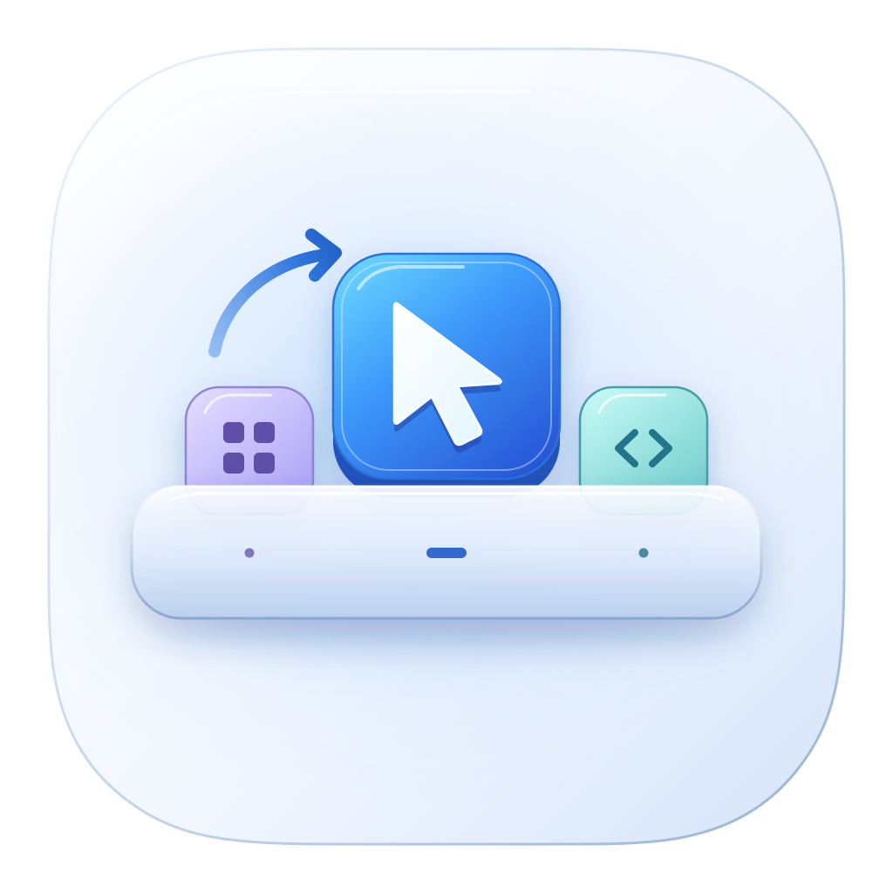

# DockRelay



DockRelay is a lightweight menu bar app that helps the Dock recover after switching macOS Spaces. It can start at login.

[简体中文](README.zh-CN.md)

## The Dock bug on macOS 27.2

With Dock magnification enabled, click an app in the Dock whose window is in another Space. Move the pointer away from the Dock while the desktop is switching. On macOS 27.2, the icon can stay enlarged even after the pointer leaves. If the pointer stays inside the Dock and moves to another icon, the previous icon can remain highlighted or enlarged for a moment.

A related report describes the Dock staying visible over a full-screen app after switching Spaces, even with the pointer well away from it. [Original report](https://www.v2ex.com/t/1254190).

DockRelay detects these stale states and can replay a missed mouse exit or move to the Dock. The cross-Space magnification and hover cases were tested on macOS 27.2 (26B123) on Apple silicon. Some animation pauses can still occur.

## Install

Download the macOS universal ZIP from the [latest release](https://github.com/linxitian/DockRelay/releases/latest). Unzip it, then move `DockRelay.app` to Applications. The release uses ad-hoc signing, so macOS may ask you to approve the app on first launch. [Apple's guidance on opening Mac apps](https://support.apple.com/en-us/102445).

To build from source with Xcode Command Line Tools or Xcode, run the following commands from the repository.

```sh
./build.sh
open build/DockRelay.app
```

## Enable and use

1. Enable **DockRelay** in the Accessibility permissions page under **System Settings → Privacy & Security**. On macOS 27.2 the page may be labeled **Device Control and Data Access**. Open its menu bar menu to refresh the status. If the menu asks for Input Monitoring, follow the system prompt and reopen DockRelay.
2. Reproduce the issue by clicking a Dock icon for an app in another Space and quickly moving the pointer away during the transition. Check **Recoveries** in the menu. The counter advances when the Dock clears after a replay.
3. For daily use, put the app in a stable Applications folder before granting access and select **Launch at Login** in its menu.

The build targets macOS 13 or later and contains Apple silicon and Intel slices. A local ad-hoc build may need a fresh Accessibility grant after rebuilding. If the existing entry appears enabled but the app says otherwise, remove the old entry and add the current app. To uninstall, turn off **Launch at Login**, quit, remove the app, and remove its privacy entries.

## How it works

- A listen-only Quartz tap observes mouse enter, exit and move events sent to the current Dock PID. The latest exit stays in memory until a new enter or Dock PID invalidates it. A genuine move beyond the sampled icon can bring the next check forward by up to 18 ms during the brief transition window. Timed checks cover transitions during which Dock receives no movement.
- A real exit can open a brief inspection window before any Space notification. DockRelay replays early when the exit was inside Dock, the cursor is now outside, and Accessibility still reports a hovered item. It takes two observations if the exit was close to the inner edge. Ordinary exits at or beyond the boundary do not qualify.
- A Space change also opens a short inspection window. DockRelay checks for a recent exit, checks the Dock through Accessibility on a separate queue. A fresh exit recorded over Dock and an item that is still hovered can trigger a replay after one observation. If the Dock only stays visible, or the exit did not originate over Dock, it waits for corroboration. Geometry uses Quartz display coordinates and the configured Dock edge. Immediately before posting, the current cursor must be clear of the Dock and any magnified item it reports.
- DockRelay copies the exit and sends it back to the same PID with a fresh timestamp and pointer location. Checks start when the Space notification arrives and spread out as the animation settles. A pending retry gets a fresh check when it becomes eligible. The app can send up to four times per exit at increasing intervals. It gives the first replay time to clear the hover. When the first send followed the Space notification and two further samples show the hovered item has not moved or shrunk, it can retry sooner. New Space changes supersede pending checks.

- If the pointer stays inside Dock during a Space switch, DockRelay checks the app icon under it. During the transition it can post a mouse-move event to Dock after the pointer crosses from the icon where the original exit happened to a different app. This covers both an old highlight and a briefly empty selection after the original hover was observed. After the Space notification it requires two samples that agree on the new target. It skips ambiguous targets and pressed mouse buttons.

There is no idle timer, network connection, or third-party runtime. The app does not record keys, click, take screenshots, move the pointer, or restart Dock. The local unified log records attach, replay, and recovery, including elapsed time from the captured exit and the Space notification. Hover diagnostics also report when a movement sample first landed in the target icon and when Accessibility reported a selection or size change. The log records state and timing without pointer coordinates. A recovery timestamp includes the time until the next check and does not measure rendered frames.

```sh
log stream --style compact --predicate 'subsystem == "io.github.linxitian.dockrelay"'
```

## Validation and limits

`./test.sh` checks the geometry for all three Dock positions, offset displays, a hidden Dock parked over an adjacent display, and the decisions for hover, unexpected visibility, and user interaction. The menu bar app was run on Apple silicon with macOS 27.2 (26B123). The tester reproduced their usual cross-Space issue, saw the Dock recover, and confirmed a nonzero recovery count. Older macOS releases, Intel, physical multi-monitor configurations, and the full-screen-only variant still need live coverage.

On the same Mac, 0.8.0 observed the correct icon selected 13–33 ms after each of 13 early hover replays. This measures the Accessibility selection, and the tester could still see an occasional pause in the magnification animation.

This is a user-session workaround. The Quartz and Accessibility calls are public APIs, but the tracking event types delivered to Dock and its Accessibility structure are implementation details. If macOS changes them, the app may no longer find or replay a usable event. A permanent fix to the Dock itself requires an Apple update.

For distribution, `SIGN_IDENTITY` selects a Developer ID Application signing identity. Use that identity and Apple notarization for a build intended to pass Gatekeeper verification by default. See [Apple's notarization guide](https://developer.apple.com/documentation/security/notarizing-macos-software-before-distribution).

## Credit

The captured enter and exit sequences and the replay idea come from [LLP2333/dockUnstick](https://github.com/LLP2333/dockUnstick/tree/3e323de2116deca69a3bb8b7280c182f670b317a). DockRelay implements its own watcher, geometry, and interface. [MIT License](LICENSE).
